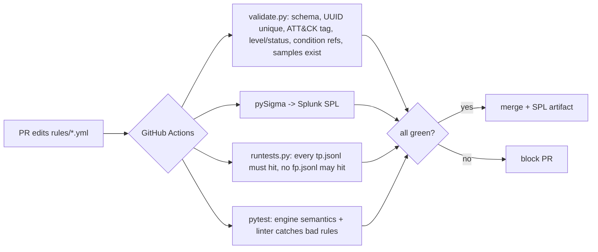

# detection-rules-as-code: Sigma rules with CI validation and replay tests

> **Lab project.** 10 Sigma rules, each with true-positive and false-positive sample events, a linter, a small Sigma evaluator, pySigma conversion to Splunk SPL, and a GitHub Actions gate. The sample events are hand-written from public attack write-ups and documentation, not taken from production.

## Problem
Detection content is often edited in the SIEM UI with no review, no tests and no history. One "small tweak" to a rule can silently flood the queue or silently stop detecting. Detection-as-code treats rules like software: version control, linting, **unit tests with known-bad and known-good events**, and CI that blocks a merge when a rule regresses.

## Architecture


## Layout
| Path | What |
|---|---|
| `rules/windows`, `rules/linux` | 10 Sigma rules (T1059.001/.004, T1003.001, T1105, T1204.002, T1490, T1070.001, T1136.002, T1543.003) |
| `tests/samples/<rule>/{tp,fp}.jsonl` | 15 TP + 16 FP events (FPs are deliberately near-misses) |
| `dac/engine.py` | Sigma evaluator: modifiers contains/startswith/endswith/re/all, wildcards, lists, and/or/not/(), `1 of x*` |
| `dac/validate.py` | linter + pySigma conversion |
| `dac/_bootstrap_rules.py` | the script that generated the first rule set (kept for transparency) |

## Run
```bash
pip install -r requirements-dev.txt
python -m dac.validate     # lint + convert to results/splunk/*.spl
python -m dac.runtests     # TP/FP replay table
pytest -q
docker build -t dac . && docker run --rm dac
```

## Results (actual run, 2026-10-11): `results/`
- `validate`: 10/10 rules lint clean. **pySigma 1.5.1 + Splunk backend 2.1.0: 10/10 converted.** Example: `Image="*\\rundll32.exe" CommandLine="*comsvcs*" CommandLine="*minidump*"`
- `runtests`: 10/10 PASS, 16/16 TP hit, 0/16 FP hit
- `pytest`: 16 passed (4 engine semantics, 10 per-rule parametrised, 2 linter)
- **Regression demo** (`results/regression_demo.log`): I changed `' -e '` to `'-e'` in the encoded-PowerShell rule, a plausible "make it catch more" edit. The FP sample `powershell.exe -File backup.ps1 -Environment prod` then matched, giving `1/2 FP hit, FAIL`, and CI goes red. I reverted the change.

## Limitations
- My evaluator only implements the Sigma subset I use. There are no aggregations or correlations, and no `|base64offset`, `|cidr` or `|windash`. pySigma conversion checks that the rules are valid for a real backend, but the SPL was **not run in Splunk**.
- 31 hand-written sample events is a unit-test suite, not a measure of real-world FP rate. Next step: replay against EVTX-ATTACK-SAMPLES / Mordor datasets (see my `evtx-triage` project).
- Field names follow the Sigma taxonomy (Sysmon-style). Real deployments need field mapping pipelines (e.g. `splunk_windows` / Sysmon).
- The `-e` substring in the PowerShell rule still misses `-ec`/`-en` abbreviations and `/e`. Known evasion, documented.
- The Docker image was not built yet.

## Sources
- Sigma spec + rule conventions: https://github.com/SigmaHQ/sigma-specification, SigmaHQ rules (style reference): https://github.com/SigmaHQ/sigma
- pySigma: https://github.com/SigmaHQ/pySigma, Splunk backend: https://github.com/SigmaHQ/pySigma-backend-splunk
- comsvcs MiniDump technique: https://attack.mitre.org/techniques/T1003/001/ ; LOLBAS certutil: https://lolbas-project.github.io/lolbas/Binaries/Certutil/
- Detection-as-code concept: Palantir ADS framework https://github.com/palantir/alerting-detection-strategy-framework
